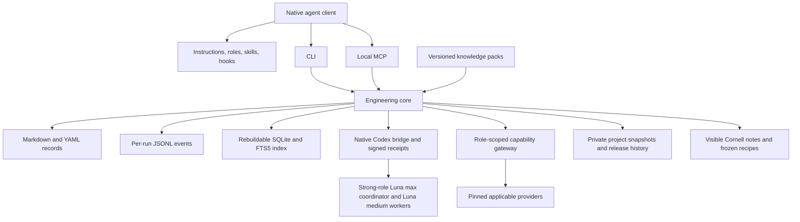

# Architecture decisions

Status: **v1 design baseline**. For current command arguments, use `verythinker --help`; for demonstrated behavior, read the project's verification report. [Research basis](research.md) separates source claims from implementation measurements.

## One package with one engineering core

The package contains a TypeScript core, CLI, local MCP server, platform adapters, portable role/skill resources, record templates, guides, packs, and pilots. CLI and MCP invoke the same operations. Alpha.3 adds a bounded native Codex App Server bridge using project-local runtime `0.162.1` and native authentication/permissions. It launches and observes native threads instead of introducing a separate model API service.

The provider assists source discovery. Reviewed requirements traceability remains in engineering records. Hooks assist execution, while gate decisions remain available through core operations when hooks are disabled.

## Autonomous native manager

Managed instructions route an ordinary requirement or batch to the manager skill. The manager persists stable increment and requirement IDs, specialist contributions, the integrated decision, bounded assignments, and closure. Native receipts bind role/workflow/task to requested and selected model, provider, effort, thread/turn, runtime/configuration hashes, interruptions, rerouting, and permission blockers. Strong roles use Luna with max reasoning effort for requirements, architecture, verification strategy, and independent review; workers use Luna with medium reasoning and evidence-based Terra fallback. [CAMEL research](camel-research.md) supplies coordination patterns adopted independently.

Assignments carry a mandatory documentation contract. Submission captures substantive seven-section work records and affected documentation hashes; acceptance requires current execution evidence and review from an invocation that has never implemented that assignment. Requirement baselines include transitive allocation ancestry. Replanning preserves superseded tasks, evidence, reports, and publication history.

Project-owned `.verythinker/automation.json` controls the manager and automatic draft PRs. Closure prepares only independently reviewed generalized candidates, records real publication results or blockers, and never merges. Operation locks serialize intake, decision/closure, and candidate publication; record preconditions and final gate checks prevent a slow publication from overwriting changed work. An explicit candidate retirement with rationale preserves obsolete publication history while allowing a corrected reviewed replacement.

## Authoritative records and query index

Markdown records with YAML metadata are readable, reviewable, and version controlled. Their stable ID survives a file rename. Metadata identifies schema version, type, title, owner, status, revision, timestamps, typed links, and type-specific data. Bodies use the packaged templates.

Record types are requirement, design, task, check, evidence, review, change, problem, and knowledge. Work records are knowledge records with `kind: work-record`. A task identifies implementation artifacts and links to the requirements and designs it implements.

SQLite indexes records, text, and relationships. Run references remain in record data and JSONL events. The index is a derived artifact, excluded from Git, and rebuilt from authoritative inputs. Index freshness is checked before queries that support acceptance. Duplicate IDs, malformed records, invalid links, and dependency cycles are reported as integrity findings.

Store each directed link once. Reverse query views permit navigation without independently maintaining inverse edges. Requirement/interface changes identify affected records for reassessment; old evidence retains its original baseline.

## Native adapters and upgrade ownership

Portable resources describe responsibilities and process. Adapters render the configuration supported by each native client. Platform/client/version entries state supported, restricted, or unverified capability. Model tiers map to available model identifiers; requested and observed identifiers are different observations.

Installed content carries version and content hashes. Upgrade unchanged managed content, preserve unrelated settings, and write reviewable candidates when a managed file was edited by its user. Existing instructions and tool configuration remain under user control.

## Knowledge boundary

Project records hold project-specific knowledge. Shared packs contain generalized lessons with provenance, applicability, assumptions, limitations, and dependencies. Projects select multiple packs and lock identity, version, and content hash. Similarity suggests candidates; applicability requires an engineering decision.

An upstream contribution remains a separate reviewed generalized candidate. Human approval precedes merging it into the shared library. Private project namespaces retain append-only working increments and immutable accepted SemVer releases. A frozen workspace snapshot preserves original record bytes and relative paths, required implementation/evidence inputs, and configuration/pack/tool/recipe locks. A manifest records file hashes, source revisions, omissions, and the captured archive baseline; publication receipts remain outside the frozen snapshot. Concurrent baseline movement triggers reassessment before fast-forward advancement.

## Practical knowledge and protected recipes

Cornell documents own readable narratives in visible project folders. Linked knowledge records store artifact hashes, sources/locators, retrieval dates, and engineering relationships. The exact quote, concrete demonstrations, explicit claim provenance, practical failure cases, and separate runnable practice/answers form the documentation contract. User solutions remain user-owned. Source and evidence freshness checks support independent review.

Versioned recipes cover Cornell evidence notes, scalar configuration persistence, and embedded hysteresis load control. Preparation freezes parameters, independent coverage/oracles, expected results, and tolerances in the design/check contracts. Reviews bind these snapshots; changing both an oracle and its instance hash cannot bypass the reviewed contract. The worker generates artifacts, and a separate check executor collects actual evidence. Unsupported tasks receive a scoped design and can later yield reviewed reusable procedures.

## Capability boundaries

Role contracts declare required tools, approved optional providers, and allowed core operations. The gateway installs applicable pinned CodeGraph, Context7, and Playwright providers into an isolated cache with integrity locks. Native restrictions are generated where supported; doctor distinguishes observed availability, configured capability, enforced restrictions, and instruction-only limits. A native permission refusal or required missing tool remains a persisted blocker.

The Developer's [scoped file-edit operation](workspace.md) provides ordinary UTF-8 implementation changes through the same core. It requires current task ownership, native capability confirmation, reviewed scope, and an expected file hash; protected acceptance artifacts and Cornell ownership remain separate. Exact previous bytes and immutable completion history remain task-linked archive inputs. Interrupted partial writes block gates until an authorized unchanged operation is recovered.

## Failure and evidence boundaries

Interrupted sessions resume by task ID, current records, working tree, and evidence. A worker submits outputs; a separate reviewer invocation assesses them. The core evaluates applicable gates and reports missing or stale evidence. Tests demonstrate their actual environments; embedded simulation results do not establish board-level behavior.

Runtime assumptions are Node.js 24 LTS, local SQLite/FTS5, and Windows as the primary verification environment. The MIT package uses independently written templates. Optional tools and source-inspired design decisions retain their own license obligations.
