# CAMEL research for autonomous VeryThinker management

VeryThinker should make the manager the default entry point for a requirement, with internal planning, specialist discussion, execution, documentation, review, and closure. CAMEL supplies useful coordination mechanisms for this change. Its Python model runtime is optional; its task completion rules must not replace VeryThinker's evidence and review gates.

## Inspected snapshot

Inspected on **2026-10-11**: repository `camel-ai/camel`, `master` commit [`24fde60ad739b4be8f8f533fea9ba54256fbc4a2`](https://github.com/camel-ai/camel/tree/24fde60ad739b4be8f8f533fea9ba54256fbc4a2). The commit's project metadata declares version **`0.2.91a7`**, Python **`>=3.10,<3.15`**, and Apache-2.0. This is a source snapshot, not a claim about the latest stable PyPI release. [Project metadata](https://github.com/camel-ai/camel/blob/24fde60ad739b4be8f8f533fea9ba54256fbc4a2/pyproject.toml)

Primary inspection covered Workforce, TaskChannel, worker implementations, structured output, workflow memory, task schemas, role playing, prompts, pipeline tests, the MCP example, and licensing. Source files were read directly at the pinned commit. [Official Workforce overview](https://docs.camel-ai.org/key_modules/workforce) provides additional public API context. No CAMEL runtime or model benchmark was executed in this research.

## Mechanisms worth adopting

| CAMEL mechanism and evidence                                                                                                                                                                                                                                                                                                                                                              | VeryThinker application                                                                                                                                                                                                                               |
| ----------------------------------------------------------------------------------------------------------------------------------------------------------------------------------------------------------------------------------------------------------------------------------------------------------------------------------------------------------------------------------------- | ----------------------------------------------------------------------------------------------------------------------------------------------------------------------------------------------------------------------------------------------------- |
| Workforce separates task decomposition, assignment, execution, and recovery. It supports an explicit pipeline with parallel branches and synchronization. [Workforce](https://github.com/camel-ai/camel/blob/24fde60ad739b4be8f8f533fea9ba54256fbc4a2/camel/societies/workforce/workforce.py)                                                                                             | The manager owns the objective; a planner produces bounded tasks; a dispatcher selects available native agents. Engineering gates define synchronization points.                                                                                      |
| `TaskChannel` wraps a task with publisher, assignee, and `SENT`, `PROCESSING`, `RETURNED`, or `ARCHIVED` state. Claims occur inside an asynchronous condition. [Task channel](https://github.com/camel-ai/camel/blob/24fde60ad739b4be8f8f533fea9ba54256fbc4a2/camel/societies/workforce/task_channel.py)                                                                                  | Persist assignment identity and worker invocation, atomically claim work, and distinguish a submitted result from engineering acceptance. Store durable discussion and decisions in project records rather than relying on an in-memory conversation. |
| Assignment schemas carry task ID, worker ID, and dependencies. Recovery strategies include retry, replan, decompose, create worker, and reassign; retry and halt behavior are configurable. The pipeline builder detects cycles. [Schemas and pipeline builder](https://github.com/camel-ai/camel/blob/24fde60ad739b4be8f8f533fea9ba54256fbc4a2/camel/societies/workforce/utils.py)       | Validate every task and response before dispatch. Preserve the existing one-repair policy; then select stronger help, split the assignment, or record an actionable blocker. Replanning cannot silently alter approved requirements.                  |
| `RolePlayingWorker` runs two complementary roles, passes dependency results, limits dialogue turns, observes termination signals, and summarizes the exchange into a structured result. [Role-playing worker](https://github.com/camel-ai/camel/blob/24fde60ad739b4be8f8f533fea9ba54256fbc4a2/camel/societies/workforce/role_playing_worker.py)                                           | Use short specialist exchanges for uncertain requirements, interfaces, and verification strategy. Persist proposals, objections, resolution, rationale, and resulting record IDs. Ordinary prescribed edits need one worker, not a debate.            |
| `StructuredOutputHandler` generates schema-oriented prompts, extracts JSON, validates fields, and applies supplied fallbacks when parsing fails. [Structured output handler](https://github.com/camel-ai/camel/blob/24fde60ad739b4be8f8f533fea9ba54256fbc4a2/camel/societies/workforce/structured_output_handler.py)                                                                      | Native clients can return the same typed assignment/submission envelopes without sharing a model API. Invalid output requires repair; it cannot manufacture a passing review or successful evidence.                                                  |
| Workflow memory generates structured summaries, stores Markdown with metadata and role organization, supports create/update, and selects relevant prior workflows. Selection falls back to role matching or recent files. [Workflow memory manager](https://github.com/camel-ai/camel/blob/24fde60ad739b4be8f8f533fea9ba54256fbc4a2/camel/societies/workforce/workflow_memory_manager.py) | Make documentation and a resumption checkpoint mandatory worker outputs. Retrieve a small number of applicable reviewed lessons, with provenance and version pointers. Similarity remains discovery rather than proof of applicability.               |

## Direct reuse and licensing

The inspected code is Apache-2.0. Section 4 permits redistribution and modification subject to its conditions: distribute the license, identify changes, retain applicable notices, and carry applicable NOTICE material if supplied. The inspected repository tree contains no file named `NOTICE`. Any copied or translated source or prompts must be tracked as Apache-origin material; they must not be presented as solely MIT-authored code. VeryThinker's own MIT files can remain MIT. [Pinned license](https://github.com/camel-ai/camel/blob/24fde60ad739b4be8f8f533fea9ba54256fbc4a2/LICENSE)

Three reuse options are concrete:

1. **Use coordination patterns now.** Independently implement the small objective lifecycle, typed discussion/assignment results, and documentation closure in the existing TypeScript core. Keep native clients responsible for actual agent invocation. This avoids adding a second model runtime or Python requirement to installation.
2. **Reuse CAMEL as an optional sidecar later.** Its example exposes `Workforce.to_mcp()` as a local MCP server, with task processing and worker management. This can connect to an MCP-capable client, but the workers still run CAMEL `ChatAgent` model backends; it is not a native Codex, Claude Code, or Copilot subagent dispatcher. Credentials, Python dependencies, permission behavior, and evidence import would require a separate adapter and conformance tests. [Workforce MCP example](https://github.com/camel-ai/camel/blob/24fde60ad739b4be8f8f533fea9ba54256fbc4a2/examples/workforce/simple_workforce_mcp.py), [ChatAgent model and tool API](https://docs.camel-ai.org/key_modules/agents)
3. **Port selected schemas or helpers only if needed.** The assignment and recovery structures are small enough to translate, with Apache attribution. VeryThinker already has dependency validation, bounded context, records, and MCP operations; copying another task store adds little value. No CAMEL source or prompt text is copied by this research report.

## Proposed native manager lifecycle

The following is a VeryThinker design recommendation, not a feature claimed for CAMEL:

```mermaid
flowchart LR
    Goal[One user requirement] --> Inspect[Inspect project and capabilities]
    Inspect --> Clarify[Resolve necessary product questions]
    Clarify --> Plan[Requirements, design, verification plan]
    Plan --> Discuss[Bounded specialist discussion]
    Discuss --> Execute[Delegate and implement]
    Execute --> Verify[Execute checks and archive evidence]
    Verify --> Review[Independent review]
    Review --> Close[Accept, document, curate, draft PR]
    Close --> Report[Manager reports final decisions]
    Review -->|Repair needed| Execute
```

The manager performs administrative core operations through MCP or CLI internally. The human provides product intent and receives the manager's decisions, actual validation, limitations, and delivered links. Routine task creation, documentation updates, check execution, repair, acceptance, and preparation of a qualified contribution are part of completing the requirement, not separate permission requests.

Use the chosen V-model profile to pair each specification/design level with its verification level. Requirements, design, implementation, checks, evidence, review, and lessons remain linked. ASPICE process mappings organize the outcomes and evidence; an agent discussion or pipeline does not establish an assessment rating.

A minimal durable objective record should contain the original request, resolved scope, assumptions, task IDs, decision references, current phase, capability limitations, and next executable action. Its closure checklist should require accepted tasks, updated seven-section work records, affected project documentation, a manager decision report, and disposition of qualified knowledge. A reviewed generalized candidate can be uploaded automatically as a draft PR to the configured and authorized upstream. Merging remains a separate release/owner action.

Human questions are limited to intent that changes the result, authority or scope that the manager cannot infer, and external blockers requiring user action. A missing upstream or credential should become a recorded contribution blocker while local closure continues. It should not make the user type every workflow command. Platform permissions still apply; no instruction or CAMEL integration can legitimately bypass a native client's denied action.

## Completion rules not to copy

CAMEL's quality evaluation uses a model-assigned score. The inspected implementation supplies score 80 when quality output cannot be parsed, and a low-quality result can enter completed-task handling after its repair limit. These are generic automation policies, not evidence-backed engineering acceptance. [Quality analysis and result handling](https://github.com/camel-ai/camel/blob/24fde60ad739b4be8f8f533fea9ba54256fbc4a2/camel/societies/workforce/workforce.py#L1645)

Pipeline tests deliberately allow a join or downstream task to run after a failed dependency, to support recovery and error handling. VeryThinker should allow diagnostic/recovery tasks while keeping dependent engineering acceptance blocked by unmet prerequisites. [Failure-continuation tests](https://github.com/camel-ai/camel/blob/24fde60ad739b4be8f8f533fea9ba54256fbc4a2/test/workforce/test_workforce_pipeline.py#L253)

Avoid treating shared conversation memory, a termination token, or a worker's successful summary as validated evidence. Use independent review, current artifact/evidence hashes, actual check receipts, and explicit documentation completeness. Bounded discussion should finish in a decision or a named unresolved question, rather than an unbounded consensus loop.

## Verification required for the change

- A single requirement selects the installed manager workflow without a long user prompt.
- Assignment discussions, decisions, documents, and resumption checkpoints survive a fresh session.
- Missing or placeholder documentation prevents objective closure.
- Native dispatch records real worker invocations and available/unknown model observations.
- Repeated failures escalate once bounded repair is exhausted.
- A failed or stale check, unresolved review, or changed baseline prevents acceptance and closure.
- An authorized, configured upstream receives only a reviewed generalized candidate, with idempotent draft-PR submission; missing connectivity becomes a precise blocker.
- The final manager report distinguishes accepted engineering work, contribution status, and platform limitations.

These checks establish the implemented behavior. CAMEL's public descriptions do not prove that native tiered routing improves VeryThinker quality, time, or cost; the comparative pilot evaluation remains necessary.
